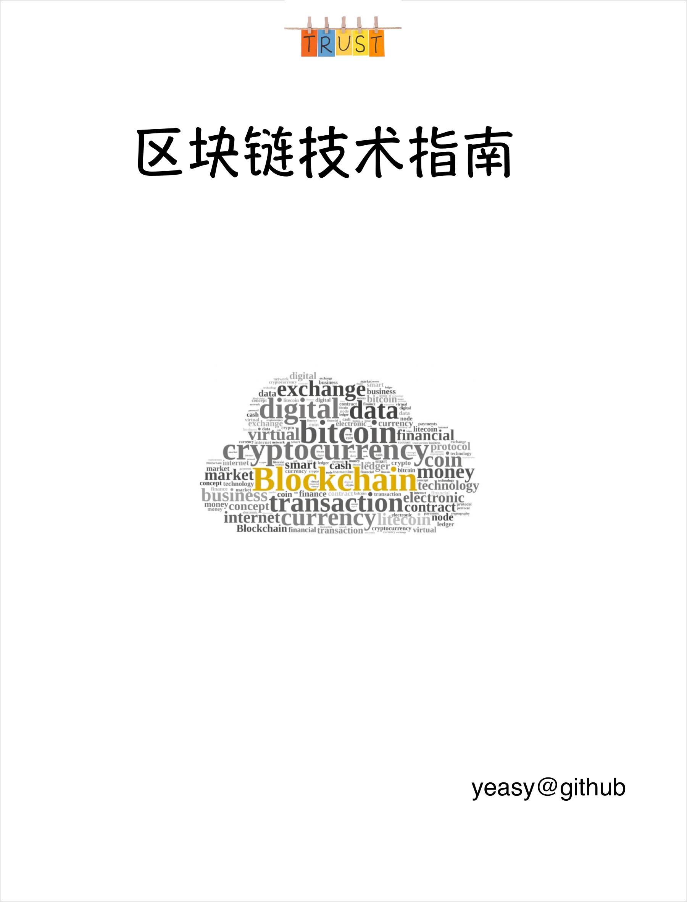
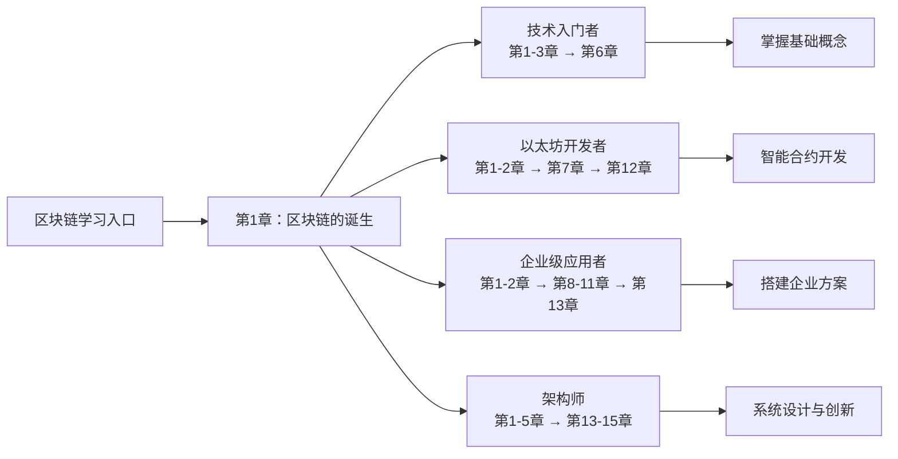
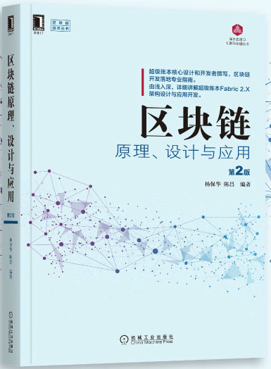

# 区块链技术指南

从分布式记账原理出发，理解比特币与以太坊，并动手部署 Fabric 网络、开发链码。

**[在 GitBook 阅读第一章 · 区块链的诞生](https://yeasy.gitbook.io/blockchain_guide/01_history)**

[全书目录（GitHub）](https://github.com/yeasy/blockchain_guide/blob/master/SUMMARY.md) · [正式 PDF（发布页）](https://github.com/yeasy/blockchain_guide/releases/latest)



## 关于本书

区块链是金融科技（Fintech）领域的一项基础性的创新。作为新一代分布式记账（Distributed Ledger Technology，DLT）系统的核心技术，区块链被认为在金融、物联网、商业贸易、征信、资产管理等众多领域都拥有广泛的应用前景。

区块链技术涉及分布式系统、密码学、博弈论、网络协议等诸多学科知识，为学习和实践都带来了不小的挑战。

本书希望能客观探索区块链概念的来龙去脉，剖析关键技术和原理，同时以 Linux 基金会生态中的重要开源分布式账本项目——超级账本为例讲解具体应用。在开发超级账本项目，以及为企业设计方案过程中，笔者积累了一些实践经验，也通过本书分享出来，希望能有助于分布式账本科技的发展和应用。

本书面向对区块链和金融科技感兴趣的读者。没有技术背景的读者可以先读基础和应用场景。

## 从哪里开始

- **区块链基础** · 先读[区块链的诞生](https://yeasy.gitbook.io/blockchain_guide/01_history)、[核心技术概览](https://yeasy.gitbook.io/blockchain_guide/02_overview)和[典型应用场景](https://yeasy.gitbook.io/blockchain_guide/03_scenario)，再从[比特币](https://yeasy.gitbook.io/blockchain_guide/06_bitcoin)了解公链的工作原理。
- **以太坊开发** · 先读[以太坊](https://yeasy.gitbook.io/blockchain_guide/07_ethereum)的核心概念，再做[智能合约开发实验](https://yeasy.gitbook.io/blockchain_guide/07_ethereum/smart_contract_labs)，最后选读 [Web3 与去中心化金融](https://yeasy.gitbook.io/blockchain_guide/12_web3)。
- **企业级 Fabric 实践** · 从[安装与部署](https://yeasy.gitbook.io/blockchain_guide/09_fabric_deploy)开始，学习[管理 Fabric 网络](https://yeasy.gitbook.io/blockchain_guide/10_fabric_op)，再按[信息公证链码示例](https://yeasy.gitbook.io/blockchain_guide/11_app_dev/chaincode_example01)练习应用开发。

<details>

<summary>全书结构与学习路线图</summary>

- **基础与应用（第 1–3 章）** · 介绍区块链的起源、定义和关键挑战，并从[典型应用场景](https://yeasy.gitbook.io/blockchain_guide/03_scenario)考察金融、溯源、政务和失败案例。
- **核心机制（第 4–5 章）** · 学习[分布式系统核心技术](https://yeasy.gitbook.io/blockchain_guide/04_distributed_system)中的一致性和共识，再读[密码学与区块链安全](https://yeasy.gitbook.io/blockchain_guide/05_crypto)。
- **公链与企业实践（第 6–12 章）** · 探索比特币、以太坊和 Web3，从[超级账本](https://yeasy.gitbook.io/blockchain_guide/08_hyperledger)了解 Fabric 的权限、通道和背书机制，并练习链码开发。
- **架构与前沿（第 13–15 章）** · 读完基础和核心机制后，从 [Fabric 架构与设计](https://yeasy.gitbook.io/blockchain_guide/13_fabric_design)了解高可用、高性能账本的设计，再读[区块链服务平台](https://yeasy.gitbook.io/blockchain_guide/14_baas)和[前沿趋势](https://yeasy.gitbook.io/blockchain_guide/15_frontiers)。



</details>

<details>

<summary>本地预览与 PDF 预览版</summary>

使用 [mdPress](https://github.com/yeasy/mdpress) 在仓库根目录启动本地预览，再打开 `http://localhost:9000`。

```bash
brew tap yeasy/tap && brew install mdpress
mdpress serve
```

[默认分支 PDF 预览版](https://github.com/yeasy/blockchain_guide/releases/download/preview-pdf/blockchain_guide.pdf)随主线更新，正式版本以发布页为准。

</details>

## 延伸阅读

<details>

<summary>纸质书《区块链原理、设计与应用》与勘误</summary>

《区块链原理、设计与应用（第 2 版）》围绕超级账本 Fabric 2.x 展开，详细介绍区块链和分布式账本的核心技术，以及企业分布式账本方案的设计、架构和应用。实践时可查阅 [Fabric 官方发布说明](https://github.com/hyperledger/fabric/releases)确认版本。该书已有多种语言版本，有意者欢迎与作者联系。



第 2 版 · [京东图书](https://item.jd.com/12935394.html) · [当当图书](https://product.dangdang.com/28996031.html) · [勘误表](https://github.com/yeasy/blockchain_guide/wiki/%E3%80%8A%E5%8C%BA%E5%9D%97%E9%93%BE%E5%8E%9F%E7%90%86%E3%80%81%E8%AE%BE%E8%AE%A1%E4%B8%8E%E5%BA%94%E7%94%A8%E3%80%8B2%E7%89%88%E5%8B%98%E8%AF%AF%E8%A1%A8)

[初版（京东）](https://item.jd.com/12159265.html)

</details>

<details>

<summary>系列图书</summary>

| 书名 | 与本书的关系 |
|------|------------|
| [《Docker 从入门到实践》](https://yeasy.gitbook.io/docker_practice) | 区块链节点的容器化部署与运维实践 |
| [《大模型安全权威指南》](https://yeasy.gitbook.io/ai_security_guide) | 密码学、安全攻防与区块链安全共通 |
| [《智能体 AI 权威指南》](https://yeasy.gitbook.io/agentic_ai_guide) | AI 智能体与区块链结合的前沿探索 |
| [《零基础学 AI》](https://yeasy.gitbook.io/ai_beginner_guide) | AI 基础入门，理解 AI + Web3 融合趋势 |

</details>

## 反馈与贡献

欢迎 [参与维护项目](contribute.md)。

* [修订记录](revision.md)
* [贡献者名单](https://github.com/yeasy/blockchain_guide/graphs/contributors)

<details>

<summary>读者交流与支持</summary>

区块链技术讨论 QQ 群

* QQ 群  IV：364824846（可加）
* QQ 群 III：414919574（已满）
* QQ 群  II：523889325（已满）
* QQ 群   I：335626996（已满）

感谢支持本书，欢迎请作者喝一杯咖啡。


[查看《区块链技术指南》的 Star History](https://star-history.com/#yeasy/blockchain_guide&Date)。

</details>

## 许可证

本书采用 [CC BY-NC-SA 4.0](https://creativecommons.org/licenses/by-nc-sa/4.0/) 许可证。

您可以自由分享和演绎，但需署名、非商业使用、相同方式共享。
